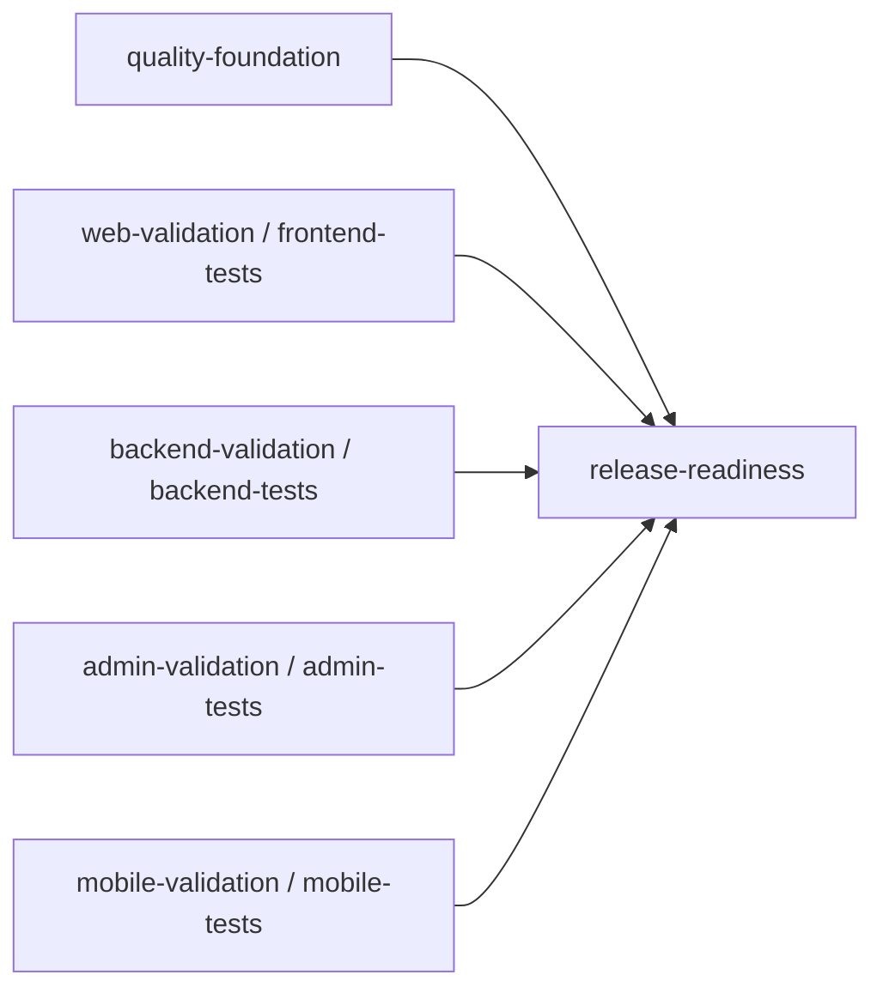

# Pipeline GitHub Actions multijob

État local du 30 octobre 2026, branche `feature/admin-web-integration`, base
`09e066e2a08f9d410378531103e3715d0b6ad07b`. Aucune publication de cette réorganisation.

## Audit et choix de regroupement

Auparavant, cinq workflows indépendants produisaient cinq graphes. Le job
`foundation` de `ci.yml` répétait les couvertures, contrôles et builds des quatre
workflows applicatifs. Les suites applicatives étaient exécutées deux fois.

Le workflow unique `.github/workflows/ci.yml`, nommé **Revynora CI/CD**, contient
désormais exactement **six jobs**, sans matrice ni workflow réutilisable cachant
des jobs supplémentaires. Les fichiers `web.yml`, `backend.yml`, `admin.yml` et
`mobile.yml` sont retirés pour empêcher une seconde exécution des mêmes suites.
Les historiques des anciens runs restent consultables sur GitHub.

| Identifiant du job   | Nom affiché / check GitHub | Dépendances `needs`      |
| -------------------- | -------------------------- | ------------------------ |
| `quality-foundation` | `quality-foundation`       | Aucune                   |
| `frontend-tests`     | `web-validation`           | Aucune                   |
| `backend-tests`      | `backend-validation`       | Aucune                   |
| `admin-tests`        | `admin-validation`         | Aucune                   |
| `mobile-tests`       | `mobile-validation`        | Aucune                   |
| `release-readiness`  | `release-readiness`        | Les cinq jobs précédents |

Les noms de checks existants sont conservés exactement : aucune modification du
ruleset distant n'est nécessaire pour cette réorganisation. Les blocs du graphe
utilisent ces noms affichés, tandis que les identifiants YAML utilisent les noms
fonctionnels demandés. Une modification ultérieure des noms affichés demanderait
une transition coordonnée des checks requis, hors de cette intervention.

Les cinq racines peuvent démarrer en parallèle, dans la limite des runners et de
la concurrence du compte. Chacune installe ses propres dépendances figées. Aucun
partage de serveur, de base ou de fichiers de build entre runners n'est requis.

## Répartition des validations réelles

| Job      | Commandes et suites conservées                                                                                                                                                                                    |
| -------- | ----------------------------------------------------------------------------------------------------------------------------------------------------------------------------------------------------------------- |
| Quality  | Frontières et 5 tests, intégrité Prisma, Prettier global, génération Prisma, lint/TypeScript/build des packages, 6 tests du collecteur d'inscription et 2 du filtre CI, couverture du client API (3 tests)        |
| Frontend | TypeScript/lint Web, couverture Web (184 tests), build API/Web/Admin requis par les navigateurs, préparation PostgreSQL, installation Chromium et 17 scénarios Web historiques                                    |
| Backend  | TypeScript/lint API, préparation PostgreSQL, suite complète avec couverture (163 tests, unitaires et intégrations), build API, images Docker runtime/migration, exécution de l'outillage de migration sans réseau |
| Admin    | TypeScript/lint/couverture Admin (49 tests), builds requis, Chromium, 25 scénarios historiques et 30 scénarios intégrés : session (19), actions G.8 (5), commercial G.9 (6)                                       |
| Mobile   | TypeScript/lint/couverture Mobile (24 tests), export Expo et contrôle en ligne des dépendances                                                                                                                    |
| Release  | Validation stricte des résultats des cinq dépendances et synthèse dans le résumé GitHub du job                                                                                                                    |

Ces nombres sont ceux des suites au HEAD de référence, réussies dans la PR #7
avant réorganisation. La nouvelle répartition prévoit **508 exécutions de tests**
par run complet réussi, dont **72 scénarios Playwright**, sans les doublons
applicatifs précédents. Aucun test, seuil de couverture ou contrôle métier n'est
modifié. Axe et les vérifications responsive existantes à 375, 768 et 1280 px
restent dans les suites navigateur correspondantes.

La couverture API passe dans le job Backend : `test:coverage` utilise le même
`vitest.integration.config.ts` que l'ancien `test:integration`, avec les mêmes
163 tests et les seuils existants. Le passage global `test:coverage` de Quality
est supprimé, puisque chaque workspace possède son passage dédié. Les builds de
support nécessaires aux E2E restent répétés sur leurs runners indépendants ; les
tests unitaires et scénarios navigateur ne le sont plus.

## Gate finale et protections

`release-readiness` utilise `needs` sur les cinq jobs et `if: always()` afin
d'évaluer aussi un échec ou un résultat ignoré. Son script Node lit uniquement
`toJSON(needs)` et exige cinq résultats `success`. Un résultat `failure`,
`cancelled`, `skipped` ou absent rend la gate rouge. Elle ne remplace aucun test
par un message et ne déploie rien. Une annulation de l'ensemble du workflow peut
également annuler cette gate ; un workflow annulé n'est pas une validation.

Le check `release-readiness` n'est pas encore requis par le ruleset : les cinq
checks historiques le restent. Son ajout éventuel aux exigences de fusion relève
d'une autorisation distincte. Aucun changement des règles GitHub n'est effectué.

Les événements restent `pull_request` vers main, `push` sur main et
`merge_group/checks_requested`, sans filtres de chemins. `contents: read`, absence
de `pull_request_target`, aucun secret de production et aucun identifiant Git
persisté par checkout. Aucun `continue-on-error` ni déploiement applicatif.

Les runners restent Ubuntu 24.04, Node 22, pnpm 10.18.3 et installation
`--frozen-lockfile`, avec cache indexé sur le lockfile. Playwright conserve sa
version verrouillée et l'installation Chromium `--with-deps`.

Frontend, Backend et Admin disposent de leur propre PostgreSQL éphémère
`revynora_test` sur loopback 5433. Frontend et Backend ont aussi Redis sur 6380.
Le garde-fou vérifie les URLs et le mode Mock avant toute préparation de base.
Les ports identiques sur des runners distincts ne sont pas partagés. Les ports
des applications restent 3000/3001/3002 pour Web, 3410/3411/3412 pour Admin
historique et 3450/3451 pour Admin intégré, avec passages séquentiels et builds
correspondants. Quality et Mobile ne préparent aucune base.

Les fournisseurs restent Mock, Stripe sans clé et les workers désactivés. Le
flag Admin reste false dans les jobs et dans l'application ; seule la
configuration du serveur navigateur intégré active explicitement le parcours de
test. Les rapports publiés restent les couvertures et résumés filtrés ; aucun
rapport brut, trace réseau ou capture sensible n'est ajouté aux artefacts.

## Validation locale et limites

- Actionlint 1.7.12 : YAML, expressions et dépendances valides ; les intégrations
  optionnelles ShellCheck et Pyflakes ne sont pas installées et sont désactivées.
- Audit structurel : six jobs, cinq racines parallèles, cinq noms requis exacts,
  événements sans filtres, runners, cache, permissions, bases et répartition unique
  des tests conformes. Les jobs Admin et Mobile sont identiques aux précédents.
- Syntaxe Node des quatre blocs inline vérifiée : trois gardes de base et gate.
- Gate exécutée localement sur cinq cas : succès accepté ; échec, annulation,
  résultat ignoré et dépendance manquante refusés.
- 13 tests Node réussis : 5 frontières, 6 collecteur, 2 filtrage CI. Contrôles de
  frontières et d'intégrité historique Prisma réussis.
- Packages : 7 tâches lint/TypeScript/build réussies ; client API, 3 tests réussis
  avec couverture 100 % lignes/statements/fonctions et 86,36 % branches.
- API : **163 tests réussis**, 26 fichiers, contre le PostgreSQL de recette isolé
  préexistant sur loopback 55439 et Redis 56389, fournisseurs Mock. Couverture :
  95,61 % lignes/statements, 88,51 % branches, 98,11 % fonctions. Aucune migration
  n'a été exécutée pour cette relance locale ; les jobs CI préparent uniquement
  leurs bases éphémères. Preuve hors Git : `/private/tmp/revynora-multijob-api.log`.
- Prettier et `git diff --check` contrôlés avant livraison.

Les applications et les scénarios E2E ne changent pas. Leurs 72 scénarios ont
réussi sur GitHub au HEAD de référence ; ils ne sont pas relancés pendant cette
réorganisation locale. Les builds Docker, l'installation Linux de Chromium et
le nouveau graphe complet ne sont pas exécutables comme un run GitHub local.
Leur validation distante reste à faire après autorisation de commit et de push.
Les validations locales utilisent macOS et Node 24, avec les dépendances figées
de la copie de recette ; elles ne constituent pas un succès CI distant nouveau.

## Recette distante à réaliser après autorisation de push

- Ouvrir le run **Revynora CI/CD** de la PR #7 au nouveau SHA et vérifier un seul
  graphe comportant les six jobs et les cinq flèches vers `release-readiness`.
- Confirmer l'exécution réelle des cinq jobs de validation, les runners Ubuntu
  24.04/Node 22, les services PostgreSQL isolés et les fournisseurs Mock.
- Lire les rapports : 17 scénarios Web, 25 Admin historiques et 30 Admin intégrés
  (19 session, 5 actions, 6 commerciaux), soit 72 réussis et aucun ignoré ;
  vérifier les assertions Axe et responsive des suites correspondantes.
- Vérifier les rapports de couverture des cinq workspaces testés et les seuils
  inchangés, ainsi que les builds applicatifs et Docker.
- Confirmer que `release-readiness` s'exécute après les cinq jobs et réussit
  uniquement avec leurs cinq résultats `success`. En cas d'échec ou de job
  ignoré, elle doit échouer ; ne pas assimiler un résultat en attente ou annulé
  à une réussite. Les simulations locales couvrent ces cas négatifs sans
  introduire intentionnellement une régression distante.
- Dans la PR, vérifier les cinq contextes historiques exacts et l'absence de
  contexte requis laissé en attente par le retrait des anciens workflows.
- Vérifier l'absence de déploiement Vercel/Oracle dans les runs, les statuts et
  l'historique de déploiement accessibles. Confirmer séparément les déclencheurs
  externes dans les consoles d'hébergement ; le blocage antérieur lié à l'accès
  Vercel ne doit pas être considéré comme levé par les seuls checks CI.
- Consigner URLs, SHA, durées, résultats et anomalies réels avant toute décision
  de fusion. Un succès sur l'ancien SHA ne valide pas ce nouveau workflow.

Le push reste soumis à une validation supplémentaire du propriétaire. Aucun
déploiement, merge ou changement du ruleset n'est autorisé par cette recette.

## Inventaire, état Git et rollback

- Modifié : `.github/workflows/ci.yml`.
- Retirés : `.github/workflows/web.yml`, `backend.yml`, `admin.yml`, `mobile.yml`.
- Ajouté : `docs/testing/CI-MULTIJOB.md`.

État contrôlé avant enregistrement : six chemins concernés, index vide et HEAD
de référence conservé. Le propriétaire autorise un seul commit local
`ci: consolidate CI into six-job pipeline` contenant ces six chemins ; son SHA
est fourni dans le rapport de livraison. Applications, API, packages, lockfile,
Prisma, fournisseurs et paramètres Vercel inchangés. Aucun push, merge, compte
de production, déploiement, migration applicative ou activation Admin.

Rollback après publication autorisée : rétablir ensemble les cinq fichiers de
workflows depuis le commit de référence. Ne pas réactiver les anciens workflows
en conservant leurs suites dans le workflow unifié, ce qui recréerait les doublons.
Les noms requis restant identiques, ce rollback n'exige pas de changer le ruleset.
